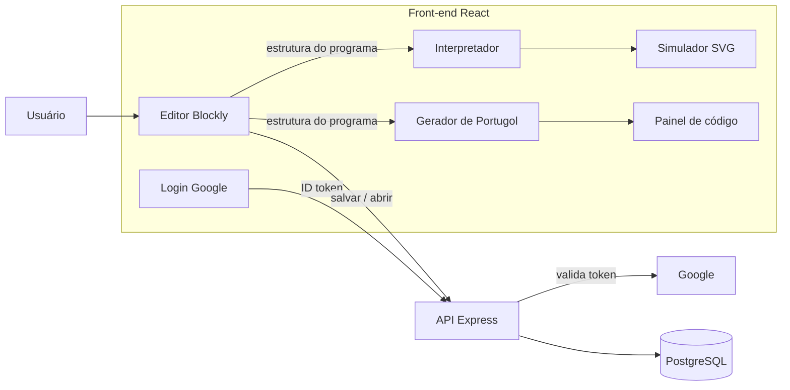

# Arquitetura em alto nível

A aplicação é organizada em três camadas: front-end, API e banco de dados.

No front-end, o editor Blockly produz a estrutura do programa montado pelo usuário. A partir dessa mesma estrutura, o **interpretador** executa os comandos no **simulador** e o **gerador** produz o código em Portugol, garantindo que as duas saídas partam da mesma representação (RNF03).

A API, em Node.js com Express, trata a autenticação e as operações sobre os programas salvos. O PostgreSQL armazena as contas, os programas e o progresso. Cada operação de leitura ou gravação verifica a identidade do usuário e a propriedade do programa.

## Partes do sistema

| Parte | O que faz |
|---|---|
| Editor Blockly | Permite montar o programa com blocos |
| Interpretador | Executa o programa comando a comando e mantém o robô dentro da área |
| Simulador | Mostra o robô andando na tela (SVG) |
| Gerador de Portugol | Transforma o programa em pseudocódigo Portugol |
| Login Google | Obtém o ID token da conta Google no navegador |
| API | Valida o token, cria o usuário no primeiro acesso e gerencia os programas salvos |
| Banco de dados | Guarda usuários, programas e progresso |

O interpretador e o gerador são módulos independentes, sem dependência da interface, para facilitar os testes automatizados (RNF05).
