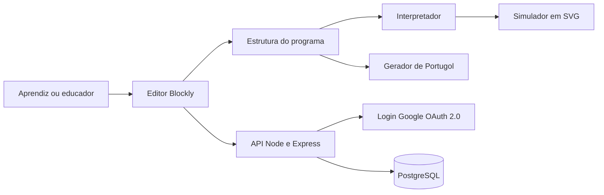

# BlocoBot

*programando passo a passo*

Projeto da disciplina Oficina de Integração 2, curso de Engenharia de Software, UTFPR campus Cornélio Procópio. Professor Antonio Carlos Fernandes da Silva.

> Os trechos entre colchetes, como [PREENCHER], ainda precisam ser completados pelo grupo. Apague este aviso quando terminar.

## Sumário

- [Sobre o projeto](#sobre-o-projeto)
- [Funcionalidades](#funcionalidades)
- [Tecnologias](#tecnologias)
- [Arquitetura](#arquitetura)
- [Como rodar](#como-rodar)
- [Variáveis de ambiente](#variáveis-de-ambiente)
- [Testes](#testes)
- [Estrutura de pastas](#estrutura-de-pastas)
- [Como o grupo trabalha](#como-o-grupo-trabalha)
- [Equipe](#equipe)
- [Documentação](#documentação)
- [Cronograma](#cronograma)

## Sobre o projeto

O BlocoBot é uma aplicação web educativa em que o usuário monta programas conectando blocos de comando. Os programas controlam um robô virtual na tela, que anda para frente, para trás, para a direita e para a esquerda, com blocos de repetição e de condição (Se). A aplicação anima o robô passo a passo e mostra o código equivalente em Portugol.

O público principal são crianças e adolescentes de até cerca de 15 anos, em fase inicial de aprendizado de lógica e programação.

A primeira versão roda toda no navegador. Não gera código em C e não usa Arduino.

## Funcionalidades

- Login somente com conta Google
- Montagem de programas com blocos
- Blocos de movimento, Repetir e Se com condição de borda
- Execução com o robô virtual, passo a passo
- Código em Portugol atualizado automaticamente
- Salvar, listar e reabrir programas
- Avisos para programas incompletos ou inconsistentes

A lista completa, com critérios de aceite, está na pasta [requisitos](requisitos/README.md).

## Tecnologias

| Uso | Tecnologia |
|---|---|
| Interface | React com TypeScript |
| Blocos | Blockly |
| Simulação | SVG |
| Servidor | Node.js com Express |
| Banco de dados | PostgreSQL |
| Login | Google, com OAuth 2.0 |
| Testes | Vitest, React Testing Library e Playwright |
| Automação | GitHub Actions |
| Ambiente | Docker |
| Organização | GitHub e Jira |

Mais detalhes em [docs/tecnologias.md](docs/tecnologias.md).

## Arquitetura

O editor Blockly produz a estrutura do programa. A partir dela, o interpretador executa os comandos no simulador e o gerador produz o Portugol. A API em Express cuida do login e dos programas salvos no PostgreSQL.



Mais detalhes em [docs/arquitetura.md](docs/arquitetura.md).

## Como rodar

### Pré-requisitos

- Git
- Docker e Docker Compose
- Node 20 ou mais novo, caso queira rodar sem Docker

### Com Docker

```
git clone [PREENCHER link do repositório]
cd [PREENCHER nome da pasta]
cp .env.example .env
docker compose up --build
```

Depois é só abrir

- Interface em http://localhost:5173
- Servidor em http://localhost:3000

Para parar, use `docker compose down`.

### Sem Docker

Você precisa de um PostgreSQL rodando e da variável `DATABASE_URL` preenchida.

Em um terminal, rode o servidor.

```
cd backend
npm install
npm run dev
```

Em outro terminal, rode a interface.

```
cd frontend
npm install
npm run dev
```

## Variáveis de ambiente

Copie o arquivo `.env.example` para `.env` e preencha os valores. O arquivo `.env` nunca deve ser enviado ao repositório.

| Variável | Para que serve |
|---|---|
| PORT | Porta do servidor |
| FRONTEND_URL | Endereço da interface |
| JWT_SECRET | Segredo usado nas sessões dos usuários |
| GOOGLE_CLIENT_ID | Identificador do login com Google |
| GOOGLE_CLIENT_SECRET | Segredo do login com Google |
| POSTGRES_USER, POSTGRES_PASSWORD, POSTGRES_DB | Dados de acesso ao PostgreSQL |
| DATABASE_URL | Endereço de conexão com o banco |
| VITE_API_URL | Endereço do servidor usado pela interface |
| VITE_GOOGLE_CLIENT_ID | Identificador do login com Google na interface |

Para conseguir o `GOOGLE_CLIENT_ID` e o `GOOGLE_CLIENT_SECRET`, [PREENCHER com o passo a passo do grupo].

## Testes

```
cd frontend && npm test
cd backend && npm test
```

Os testes de ponta a ponta ficam na pasta `tests` e usam Playwright. A meta de cobertura é de pelo menos 80% no interpretador e no gerador.

Os testes rodam sozinhos no GitHub Actions a cada envio de código e a cada pull request. A estratégia completa está em [docs/testes.md](docs/testes.md).

## Estrutura de pastas

```
.github/workflows/   automação dos testes
docs/                documentos do projeto
frontend/            interface em React
backend/             servidor em Express
tests/               testes de ponta a ponta
requisitos/          requisitos funcionais, não funcionais e regras de negócio
docker-compose.yml   sobe o ambiente completo
.env.example         modelo das variáveis de ambiente
```

## Como o grupo trabalha

- Scrum com dois sprints e revisão ao final de cada um
- Cada funcionalidade vira uma issue no GitHub, com critérios de aceite e testes esperados
- Quadro Kanban no Jira ([PREENCHER link do quadro]) com as colunas Backlog, A fazer, Em andamento, Em revisão e Concluído
- Commits e pull requests citam a issue correspondente
- Vídeo de até cinco minutos ao final de cada sprint
- Reunião com o professor a cada duas semanas

Mais detalhes em [docs/processo.md](docs/processo.md).

## Equipe

| Pessoa | Responsabilidade | GitHub |
|---|---|---|
| Luana Monteiro Ferreira | PO e documentação | [PREENCHER] |
| Maria Fernanda Leal Pinheiro (Mafe) | Design e front | [PREENCHER] |
| Kenji Kato | Front | [PREENCHER] |
| Ricardo Lima | Servidor e banco | [PREENCHER] |
| Paulo André Oliveira da Silva | Testes e banco | [PREENCHER] |

Todos se ajudam. O responsável de cada área garante a entrega e cuida dos documentos daquela área.

## Documentação

- [Descrição do sistema](docs/descricao-do-sistema.md)
- [Arquitetura](docs/arquitetura.md)
- [Tecnologias](docs/tecnologias.md)
- [Estratégia de testes](docs/testes.md)
- [Processo de desenvolvimento](docs/processo.md)
- [Cronograma](docs/cronograma.md)
- [Requisitos](requisitos/README.md)

## Cronograma

| Fase | Período | Resultado |
|---|---|---|
| Planejamento | 28/09 a 16/10 | Repositório inicial, requisitos e apresentação |
| Sprint 1 | 19/10 a 13/11 | Login com Google, editor de blocos, movimentos e primeiro simulador |
| Sprint 2 | 16/11 a 11/12 | Repetir, Se, Portugol, programas salvos, integração e testes completos |

As datas depois de 16/10 são uma proposta e serão ajustadas quando o professor passar o calendário da disciplina. O detalhe está em [docs/cronograma.md](docs/cronograma.md).
