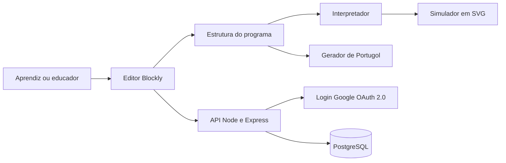

# Arquitetura do sistema

## Visão geral

A aplicação tem três camadas, que são front-end, API e banco de dados.

No front-end, o editor Blockly produz a estrutura do programa montado pelo usuário. A partir dessa mesma estrutura, o interpretador executa os comandos no simulador e o gerador produz o código em Portugol. Assim os dois sempre partem da mesma base.

A API, feita em Node.js com Express, cuida do login e das operações sobre os programas salvos. O PostgreSQL guarda as contas, os programas e o progresso. Cada leitura ou gravação confere quem é o usuário e de quem é o programa.

## Diagrama

## Camadas

| Camada | Tecnologia | Responsabilidade |
|---|---|---|
| Front-end | React com TypeScript | Interface, editor de blocos, interpretador, simulador e gerador de Portugol |
| API | Node.js com Express | Login com Google e operações sobre os programas salvos |
| Banco de dados | PostgreSQL | Contas, programas e progresso |

## Módulos

| Módulo | Camada | O que faz |
|---|---|---|
| Editor de blocos | Front-end | Usa o Blockly, com blocos próprios para os comandos do robô, para o usuário montar o programa |
| Interpretador | Front-end | Executa a estrutura do programa e atualiza a posição do robô |
| Simulador | Front-end | Desenha o robô e a área de execução em SVG |
| Gerador de Portugol | Front-end | Transforma a estrutura do programa em código Portugol |
| Autenticação | API | Valida a identidade do usuário no login com Google |
| Programas salvos | API | Salva, lista, carrega e atualiza os programas de cada usuário |
| Persistência | Banco de dados | Guarda contas, programas e progresso |

## Fluxos principais

**Montar e executar um programa.** O usuário monta os blocos no editor. O editor gera a estrutura do programa. O interpretador percorre essa estrutura, na ordem dos blocos, e o simulador anima o robô na tela.

**Ver o código em Portugol.** A cada mudança nos blocos, o gerador lê a mesma estrutura do programa e atualiza o Portugol na tela.

**Entrar no sistema.** O usuário entra com a conta Google. A API valida a identidade e, no primeiro acesso, cria o cadastro mínimo.

**Salvar e reabrir.** A API grava o programa e o progresso na conta do usuário. Ao reabrir, ela confere se o programa pertence a quem pediu.

## Decisões de projeto

- Interpretador e gerador leem a mesma estrutura do programa, o que garante que a simulação e o Portugol tenham a mesma interpretação (RNF03)
- Interpretador e gerador são módulos independentes, o que facilita os testes e a manutenção (RNF05)
- Toda a execução acontece no navegador, sem envio de comandos a equipamentos externos (RN07)
- Cada operação de leitura ou gravação confere a identidade do usuário e a propriedade do programa (RN06)
