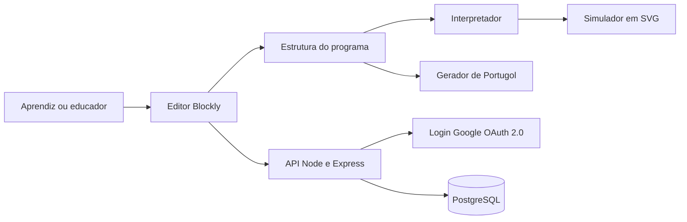

# Arquitetura

A aplicação tem três camadas, que são front-end, API e banco de dados.

No front-end, o editor Blockly produz a estrutura do programa montado pelo usuário. A partir dessa mesma estrutura, o interpretador executa os comandos no simulador e o gerador produz o código em Portugol. Assim os dois sempre partem da mesma base.

A API, feita em Node.js com Express, cuida do login e dos programas salvos. O PostgreSQL guarda as contas, os programas e o progresso. Cada leitura ou gravação confere quem é o usuário e de quem é o programa.

## Partes do sistema

| Parte | O que faz |
|---|---|
| Editor Blockly | Deixa o usuário montar o programa com blocos |
| Interpretador | Executa os blocos e atualiza a posição do robô |
| Simulador | Desenha o robô e a área de execução em SVG |
| Gerador de Portugol | Transforma os blocos em Portugol |
| API | Login e operações sobre os programas salvos |
| Banco de dados | Guarda contas, programas e progresso |

O interpretador e o gerador são módulos independentes. Isso facilita os testes e permite mexer em uma parte sem afetar as outras.
